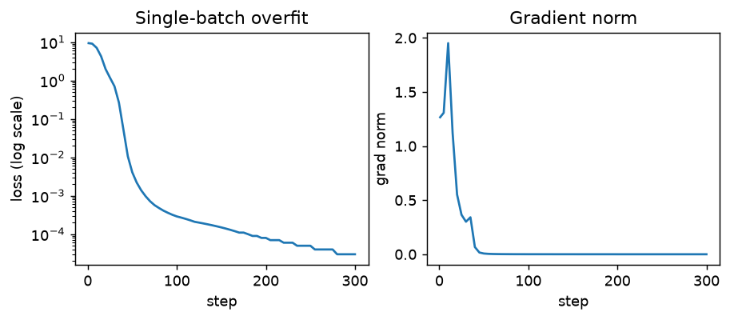
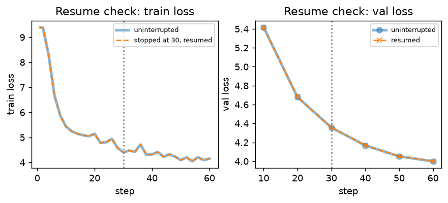
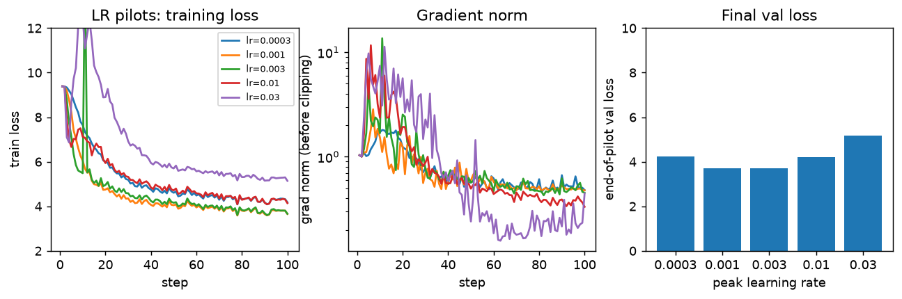
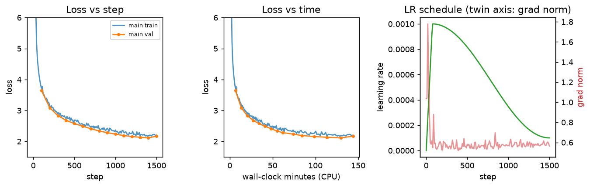

# Small language model from scratch — writeup

**Everything here was produced by the code in this repo** (`tests/` all pass; raw outputs behind each number are in `report/analysis/`, `report/logs/` and `artifacts/`). Model: 4 layers, d_model 512, 16 heads, d_ff 1,344, vocab 10,000, context 256 → **22,696,448 parameters**.

## 0. Honest scope: what was run, and what was not

I had no GPU: all numbers come from a **laptop CPU (Intel Core 5 210H, 8 cores, 15 GB RAM), fp32**. At ~8 s per step of batch 32 the specified 5,000-step run (~11 h) was out of reach, so the training runs are scaled down. Everything else (tokenizer on the full 2.2 GB file, all code and tests) is at full spec.

| | Assignment | What I ran |
|---|---|---|
| Tokenizer / data | 10k BPE, encode both files | as specified (full train file, 541M tokens) |
| LR pilots | 4–5 rates × ~300 steps, batch 32 | 5 rates × **100** steps, **batch 16** (3e-4, 1e-3, 3e-3, 1e-2, 3e-2) |
| Main run | 5,000 steps × 32 × 256 = 41M tokens | **1,500 steps × 16 × 256 = 6.14M tokens** (15 % of the spec), peak lr 1e-3, 144 min |
| Precision | fp16 + GradScaler on a T4 | fp32 on CPU (the fp16/`GradScaler` path is implemented and unit-tested, but not exercised on a GPU) |
| Optional extras | architecture experiment, Docker | **not run** (no GPU time; no Docker on this machine – a `Dockerfile` is included but untested) |

`notebooks/colab_full_run.ipynb` runs the full-spec pipeline on a T4 with the same scripts. **Consequently my final loss is much higher than the 2.0 stretch target, and that is a compute limit, not a bug** (see §7 and §9).

## 1. Part 1 – BPE tokenizer

**Warm-ups** (`report/analysis/warmups.txt`). (1) `chr(0)` is the NUL character `'\x00'`; `repr` shows an escaped, visible description, while `print` writes the raw invisible NUL byte. (2) UTF-8 is ASCII-compatible (1 byte per English character: `'hello'` = 5 B vs 12 B in UTF-16 and 24 B in UTF-32), has no byte-order/BOM issue and no padding zero bytes that BPE would waste merges on; it is not always the smallest (Hindi `'नमस्ते'`: 18 B UTF-8 vs 14 B UTF-16), but a 256-symbol base alphabet that covers every string is the point. (3) Decoding byte-by-byte is wrong because one character can span several bytes: `'café'` = `63 61 66 c3 a9`, and `bytes([0xc3]).decode()` raises `UnicodeDecodeError` (unexpected end of data). (4) `bytes([0xC3, 0x28])` is invalid: `0xC3` (`110xxxxx`) announces a 2-byte character whose second byte must be `10xxxxxx`, but `0x28` is `00101000`. (`0xFF` and a lone `0x80` are invalid too.)

**Implementation / tests.** `train_bpe` splits on the special token, GPT-2 pre-tokenises, counts pre-tokens (multiprocessing, chunks cut only at `<|endoftext|>`), and merges with incremental pair counts + a lazy max-heap (ties → larger byte-pair tuple). Tests: the hand-worked low/lower/widest/newest example gives exactly `s t, e st, o w, l ow, w est, n e`; no token mixes bytes from two stories; vocab size exact, ids and tokens unique; merges only reference earlier tokens; multiprocess counts equal single-process counts.

**Real run** (`artifacts/tokenizer/train_stats.json`): full 2.23 GB train file, 8 processes: **205 s** total (**201 s pre-tokenising**, 4.5 s merging 9,743 merges); peak memory (all processes) **1.4 GB**; 59,933 distinct pre-tokens out of 536.6M. The **longest token is `" accomplishment"`** (15 bytes, id 7160): it makes sense – a space-prefixed, frequent whole word, and TinyStories (GPT-4-written, moral-of-the-story style) uses it a lot.

**Q1 – profile (cProfile, single process, 22.5 MB valid file, `report/analysis/profile_bpe.txt`).** `train_bpe` took 6.5 s: **pre-tokenising 5.5 s (85 %)**, merging 0.96 s (15 %). Almost all pre-tokenising time is the regex scan + `Counter` update over 5.4M pre-tokens; merging is cheap because only pre-tokens containing the merged pair are touched and the best pair comes from a heap. On the full 2.2 GB file the split is even more lopsided (201 s vs 4.5 s, **98 % / 2 %**): pre-tokenising grows with file size, while merging depends only on the ~60k *distinct* pre-tokens. So the time goes into splitting into pre-tokens, and that is the part worth parallelising (which I did).

## 2. Part 2 – Encode / decode

Hand-worked tokenizer test (`the cat ate` → `[9, 7, 1, 5, 10, 3]`), exact round-trip (English, Hindi, emoji, empty, newlines, random unicode), `<|endoftext|>` always exactly one id (longest-match for overlapping specials), no merges across it, `encode_iterable` ≡ `encode` (also with chunks cut inside a special token), invalid bytes decode to `�`. Both files saved as `uint16` `.npy`.

**Compression (10 random valid stories, seed 0):** 3.83–4.84, **mean 4.15 bytes/token** (pooled 4.14); whole valid file 4.117, train file 4.116 (22.5 MB → 5,465,883 tokens; 2.23 GB → **541,229,347 tokens**, max id 9,999). **Speed:** single process, cold cache, valid file: **8.2 s = 2.74 MB/s (666k tokens/s)**; `encode_iterable` 15.2 s (same ids, bounded memory). The 2.23 GB train file took **238 s with 8 processes (9.4 MB/s)** (`report/analysis/tokenizer_stats.json`, `report/logs/*.stats.json`).

**Q2 – why `uint16`?** ids are < 10,000 < 2¹⁶ = 65,536, so two bytes hold each id exactly: the 541M-token train file is **1.08 GB** instead of 2.16 GB (`int32`) or 4.3 GB (`int64`), which matters for disk, page-cache and `mmap` reads (the batch sampler touches random windows). It stops being enough once the vocabulary exceeds 65,536 ids (Llama-3's 128k, Gemma's 256k) – then use `uint32`. (PyTorch has no general `uint16` ops, so `get_batch` casts the sampled windows to `int64`.)

## 3. Part 3 – Layers

Tests (`tests/test_layers.py`): hand-written causal attention equals `F.scaled_dot_product_attention` to 1e-5 for 2-D…5-D inputs; RoPE equals a slow version that builds the full block-diagonal rotation matrix; RoPE keeps vector norms, is the identity at position 0, and its `cos/sin` are non-persistent buffers; every piece keeps its shape with 0–3 extra batch dims; the attention layer equals a manual computation from its own weights (RoPE on q,k only); changing future inputs leaves earlier outputs unchanged; SwiGLU equals `W2(SiLU(W1x)·W3x)`; a KV-cached forward equals the full forward.

**Q3 – why divide by √d_k?** For q, k with unit-variance entries, q·k is a sum of d_k = 32 products so it has variance d_k: measured std **5.69** (theory √32 = 5.66) vs **1.005** after dividing. Softmax over 16 random keys (20,000 trials): without scaling the largest probability averages **0.78** and the entropy is **0.61 nats** (uniform = 2.77) – nearly one-hot; with scaling **0.25 / 2.36 nats**. A one-hot softmax has almost zero gradient (Σp(1−p) = 0.31 vs 0.87), so unscaled attention starts saturated, learns slowly and becomes more unstable as d_k grows; the 1/√d_k keeps score variance ≈ 1 independent of d_k.

**Q4 – RoPE is relative.** `(R_i q)·(R_j k) = qᵀ R_iᵀ R_j k = qᵀ R_{j−i} k` because 2-D rotation angles add. Numbers (d_head = 32, same random q, k; `warmups.txt`): for i−j = 3 the dot product is **−3.482755** at (i,j) = (3,0), (10,7), (53,50), (203,200), (403,400) (spread 4.8e-7, float32 rounding); i−j = 10 gives −1.294335 at all five positions; i−j = 0 gives −2.053212 = the un-rotated q·k. Different distances give different values (−3.04 for 1, −3.48 for 3). Also unit-tested.

## 4. Part 4 – Model, parameters, FLOPs

Tests: logits `(2,17,10000)`; **no peeking at the future** – changing tokens after position t leaves logits ≤ t *exactly* equal (`torch.equal`), plus a negative control (a leaky, non-causal attention is detected by the same test); initial loss on random tokens is within 0.5 of ln 10,000 = 9.21 (comment in the test explains: near-uniform prediction ⇒ cross-entropy ≈ ln V; measured start of training: **9.39**); parameter count by hand = code.

**Q5 – parameters** (`report/analysis/params_flops.txt`): embedding 10000·512 = 5,120,000; per block: attention 4·512² = 1,048,576, SwiGLU 3·512·1344 = 2,064,384, 2 RMSNorms 1,024 → 3,113,984 (×4 = 12,455,936); final norm 512; output layer 5,120,000. **Total 22,696,448 = `sum(p.numel())`**. Embedding + output = 10,240,000 = **45.1 %** of all parameters (transformer layers 54.9 %).

**Q6 – matmul FLOPs, one forward pass of 256 tokens (2mnp each)**, per layer: q,k,v,o projections 4 × 134,217,728 = 536,870,912; QKᵀ 16 heads × 2·256·32·256 = 67,108,864; weights·V 67,108,864; FFN w1, w3, w2: 3 × 352,321,536 = 1,056,964,608 → 1,728,053,248 per layer, ×4 = 6,912,212,992; output layer 2·256·512·10,000 = 2,621,440,000. **Total 9.534 GFLOPs** (torch's `FlopCounterMode` gives exactly the same number); forward+backward ≈ 3× = 28.6 GFLOPs. The **feed-forward blocks do the most work (44.3 %)**, then the output projection (27.5 %), attention projections (22.5 %); the attention score/value matmuls are only 5.6 %.

**Q7 – GPT-2-small size** (12 layers, d 768, 12 heads, V 50,257, context 1,024; I use SwiGLU d_ff = 2,048, which costs exactly the same as GPT-2's 2-matrix 4d = 3,072 MLP): 162.1M parameters (embedding+output 47.6 %), **291.6 GFLOPs** per 1,024-token forward pass: FFN 39.8 %, output layer 27.1 %, attention projections 19.9 %, **attention scores + values 13.3 %** (2.4× our 5.6 %). As the model grows, the layer matmuls (∝ d²) and the output layer (∝ d·V) scale similarly so their shares stay comparable, but the attention-score term grows ∝ T²·d with context length, so its share rises; with a larger d the FFN/projection share would dominate the (fixed-V) output layer more and more.

## 5. Part 5 – Training set-up

All pieces are tested (`tests/test_training.py`): cross-entropy equals a hand-computed −log-softmax; AdamW (β 0.9/0.95, wd 0.1) with two groups – matrices decay, the 9 RMSNorm weight vectors do not – together containing every parameter exactly once (also with tied weights), and zero-gradient steps shrink only the decay group; the LR schedule equals hand-computed values at t = 0, 5, 10, 35, 60, 110, 500 and `LambdaLR` follows it; after `clip_grad_norm_(…, 1.0)` the total norm ≤ 1; **`train_step` unscales before clipping** – with a loss-scale of 1,024 the reported grad-norm and the weight update equal the unscaled run (clipping scaled gradients would report ~1000× too large); autocast loss ≈ fp32 loss (< 0.05) in fp16 and bf16; `get_batch` targets = inputs shifted by 1, contiguous, never past the end, last token reachable, works on `mmap`; the validation batches are **fixed** (same seed ⇒ identical every time); **checkpoint resume** reproduces the next 5 losses to < 1e-5 (and a negative control – restoring only the weights – is detected).

**Warm-up (SGD on mean(w²), 10×10, 5·randn, 10 steps).** Loss 26.3 at the start; the gradient is 0.02·w so an SGD step maps w → (1 − 0.02·lr)·w and the loss is multiplied by (1 − 0.02·lr)² per step. lr = 1: factor 0.96 – slow decay, **26.3 → 18.3**. lr = 10: factor 0.64 – fast, **→ 0.47**. lr = 100: factor (−1)² = 1 – w flips sign every step, loss **stuck at 26.3**. lr = 1000: factor 361 – **diverges to 2.7e24**. Too small is slow, the optimum is fast, 2/ (curvature) is the edge, beyond it every step overshoots further.

**`torch.compile`.** *Not measurable here:* on this Windows CPU `torch.compile` fails with `InvalidCxxCompiler: Compiler: cl is not found` (no MSVC; `report/analysis/compile_benchmark.json`). Eager baseline: 4.1 s/step (batch 16, 8 threads, quiet machine; 8 s at batch 32). `scripts/benchmark_compile.py` times eager vs compiled and `train.py --compile` is wired in; the Colab notebook runs it on a T4. (Other CPU findings: 12 threads was 3× *slower* than 8 – 12.3 vs 4.1 s/step; bf16 autocast on this CPU is far slower than fp32.)

**Q8 – memory (fp32).** parameters 22,696,448 × 4 B = **90.8 MB**; gradients **90.8 MB**; AdamW state **181.6 MB**; total **363 MB** (16 bytes/parameter; measured: the optimizer holds exactly 2.00× #params elements). AdamW keeps **two** extra tensors per parameter – the exponential moving average of the gradient (m, 1st moment) and of the squared gradient (v, 2nd moment) – each as large as the weights, hence the state is ≈ 2× the weights (and activations, not counted here, come on top).

## 6. Part 6 – train.py, checks, learning rate

`train.py`: every setting is a flag or `--config file.json`; data via `np.load(mmap_mode="r")`; validation on the same fixed batches (a prefix of one fixed set for the periodic evals, the full set at the end); CSV log of step, train loss, val loss, lr, grad-norm, elapsed time, tokens; checkpoints + `--resume`.

*Single-batch check (real 22.7M model, batch of 4 sequences repeated): loss 9.40 → 3e-5 in 300 steps; grad-norm peaks at 1.9 then → 0 (finite, not growing).*

*Resume check: run 60 steps vs. stop at step 30 and `--resume`: the curves coincide (max |Δ train loss| = 0.0 over all 31 logged points).*

**Gradient norms** in the first 100 steps (pilot at lr 1e-3, `report/figures/fig_lr_pilots.png`): all finite; ≈1.0 at init, a transient of up to 2.8 during warm-up while the loss falls from 9.4 to 5, then settles at ≈0.5 and stays flat.

*Five pilots (100 steps, batch 16, 5 % warm-up, cosine to 0.1×): training loss, gradient norm before clipping, and end-of-pilot validation loss on a fixed set.*

**How I chose the rates:** a log grid with half-decade spacing (3e-4 … 3e-2, 100× range) to bracket the optimum; I added 3e-2, above the suggested 1e-2 limit, to be sure one rate clearly broke. Pilots were 100 steps at batch 16 (compute), one seed each.

| peak lr | end val loss | max train loss | max grad-norm | verdict |
|---|---|---|---|---|
| 3e-4 | 4.230 | 9.39 (start) | 1.8 | stable, too slow |
| **1e-3** | **3.707** | 9.39 (start) | 2.8 | **best, stable → used** |
| 3e-3 | 3.713 | **14.8 at step 11** | 13.6 | loss spike in warm-up, recovered |
| 1e-2 | 4.206 | 9.39 (start) | 11.7 | unstable gradients, stalls |
| 3e-2 | 5.179 | **12.5 at step 9** | 11.3 | blew up, did not recover |

**Q9.** The rate that blew up (3e-2) sent the loss from 9.4 up to 12.5 during warm-up with gradient norms ≈ 11 (~20× the healthy ≈ 0.5) and ended at 5.18 vs 3.71 for the best (no NaN: clipping + fp32 absorbed it). 3e-3 spiked too (loss 14.8, grad-norm 13.6) but recovered and *tied* the best (3.713 vs 3.707); 1e-2 was worse again. So yes, the best rate sits right below the point where training becomes unstable: 1e-3 is the largest rate with a clean curve, 3× below the first spiking rate and 30× below the one that broke. Caveats: 100 steps, one seed, so 1e-3 vs 3e-3 is a statistical tie; following the "stay below unstable rates" rule I used **1e-3**.

## 7. Part 7 – Main run

Settings: lr 1e-3 (best pilot), 5 % warm-up (75 steps), cosine to 1e-4 reached exactly at the last step, batch 16 × 256, **1,500 steps = 6,144,000 tokens**, fp32 CPU, seed 0. **Final validation loss 2.170, perplexity e^2.170 = 8.76**, measured on a fixed set of 30 × 32 windows (245,760 tokens) of the *valid* file; it took 144 min (avg 5.8 s/step – 4 s at the start, up to ~8 s later, probably thermal throttling, which is why loss-vs-time is not a straight rescaling of loss-vs-step).

*Loss vs step and vs wall-clock time (validation every 100 steps on the first 2 fixed batches), learning-rate schedule and grad-norm (max 1.78, median 0.57, never NaN).*

Reading the curve honestly: the last point (2.170) uses the full 30-batch set, the others use its first 2 batches; on those same 2 batches the final model scores **2.101** (step 1400: 2.113), so there is no regression. Train loss (2.20 averaged over the last 10 steps; 2.15 on a fixed training sample) ≈ val loss: no over-fitting, the model has seen 6.1M tokens, 1.1 % of one epoch. **I did not reach the 2.0 stretch target; the reason is budget** – 15 % of the specified tokens and 30 % of the steps, with the curve still falling ~0.02 per 100 steps as the learning rate decays – not a code defect (masking, validation set, loss and unscaling are all tested). Whether 5,000 steps would reach 2.0 I have not tested.

**Stories** (`report/stories.md`, prompt "Once upon a time", ≥ 256 new tokens each, two settings; first lines):
* T = 0.7, top-p 0.9 (seed 0): *"…there was a little girl named Lily. Lily loved to play with her toy car. One day, she found a big, shiny ball of yarn in her yard…"* (continues about cars, ends mid-sentence at the token limit)
* T = 0.7, top-p 0.9 (seed 1049): *"…a little girl named Mia. Mia loved to play outside in the sun. One day, she found a big, red ball in her yard. It was a very yummy cake…"*
* T = 1.0, top-p 0.95 (seed 9): *"…there was a tall teddy bear. The bear loved to slide and have fun…"* (later: *"Someone embarrass mer."*)

**Q10 – fluency.** Sentence by sentence the stories are fluent: simple grammar, consistent names, correct dialogue punctuation, the TinyStories voice. Over a few hundred tokens they are not coherent: the plot wanders (a ball of yarn becomes a toy car, a ball is "a very yummy cake"), characters swap roles, sentences repeat ("play with the car" many times) and nothing resolves. Two things clearly change quality: **(1) sampling settings** – T = 0.7/p = 0.9 keeps grammar clean but is repetitive, while T = 1.0/p = 0.95 is more varied yet produces word salad ("feel have hot", "Thanks following us from something?") because the 5 % tail of a weak model's distribution contains many wrong tokens; **(2) model size and training budget** – 22.7M parameters, 6M training tokens and a 256-token window are enough for local grammar but not for tracking who has what across a story (the lower loss a longer run reaches would mostly show up here).

## 8. Part 8 – Packaging

`release/` has exactly `model.pt` (90.8 MB, weights only), `config.json`, `vocab.json`, `merges.txt`; `inference.py` rebuilds the model from `config.json`, loads with `map_location`, imports only `minilm.model/tokenizer/generate` (checked: `minilm.train` is not imported) and prints the story plus a tokens/s line. **Acceptance test run:** copied the repo (without data, tests, training outputs) to a new folder, created a new venv, `pip install -r requirements.txt` (only torch 2.15 CPU, regex, einops, numpy), ran the README command: it printed a story and `Generated 136 tokens in 0.80s (170.6 tokens/s)` (the model emitted `<|endoftext|>` after 136 tokens); a second run with `--seed 42` printed the identical story. A subprocess test of `inference.py` (same-seed reproducibility) is also part of `pytest`. Docker: a `Dockerfile` (python:3.11-slim, CPU-only torch) is provided but **not built or tested** – there is no Docker on this machine.

**Q11 – CPU speed and the KV cache.** Machine: Intel Core 5 210H laptop, 8 threads, Windows 11, torch 2.15 (CPU), no GPU. Generating 256 tokens (4-token prompt, best of 3, quiet machine, `report/analysis/inference_benchmark.json`): **156 tokens/s with the KV cache (1.64 s)**, **44.9 tokens/s without (5.7 s)**. (A first measurement taken while other jobs ran gave 39 vs 9 tok/s – discarded; CPU timings are noisy.) Without a cache every step re-runs the model over the whole text: to produce 256 tokens the network processes 33,658 token positions although only 259 (4 prompt + 255 new) are new – **≈ 99 % of the token work is repeated** (96.9 % in my implementation, which also recomputes the last few steps because the 256-token window slides). Counting FLOPs the cache could therefore save ~100×, but the measured saving is only **3.5×**: a one-token step cannot use the CPU efficiently (it streams all 91 MB of weights and launches many small ops per token), whereas the uncached pass spreads each weight load over up to 256 positions. The gap would be wider for a bigger model or longer text, where attention cost grows quadratically without the cache.

## 9. Bugs vs. model limits

**Mistakes in my code, found by tests/measurements and fixed:** (1) `train.py` wrote an extra CSV row at the resume step, so the resumed log did not line up with the uninterrupted one – caught by the resume test. (2) `inference.py` crashed printing non-ASCII text on Windows (cp1252 console) – caught by the subprocess test; stdout is now UTF-8. (3) Measurement mistakes: a first cProfile showed 6,611 s (a wall-clock jump while the laptop slept; the re-run gives 6.5 s) and the first inference benchmark ran while other jobs were busy (39 vs 156 tok/s) – both re-measured on a quiet machine. (4) Using 12 threads instead of 8 made training 3× slower; bf16 autocast on this CPU is far slower than fp32 – both left at the fast setting. No NaNs, loss spikes or mask/validation bugs occurred in the final run.

**Limits of a small model trained briefly (not bugs):** val loss 2.17 vs the 2.0 stretch target (15 % of the tokens, CPU-only); repetitive, incoherent long stories; 3e-3 and above spike during warm-up (a property of the learning rate, absorbed by clipping); `torch.compile`, fp16/GradScaler on a GPU, Docker and the optional architecture experiment were **not run** here.
